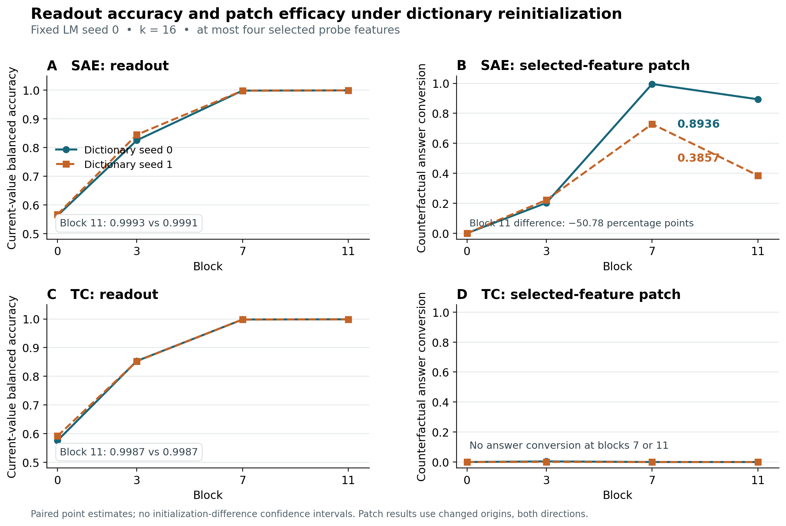

# State Representations and Causal Interventions in a Transformer Trained on Boolean Programs

**Research question:** If a sparse feature reads out the model's current state well, can it also change the model's answer about that state?

This project trains Transformers on Boolean programs and compares linear probes, sparse autoencoders (SAEs), and transcoders (TCs) on them. The main observation is that **high accuracy at reading out the state does not always match the effect of intervening at the chosen position**.

## Experiment flow

```text
Generate Boolean programs and check the answers by independent execution
    → Train 3 Transformers, check them with a behavioral gate, and freeze them
    → Extract activations at the same READ positions
    → Train full probes and SAEs / TCs
    → Evaluate semantic accessibility, reconstruction, single-position substitution, and counterfactual patching
    → Repeat sparse initializations and quantify uncertainty
    → Aggregate the final results
```

| Key setting | Value |
|---|---|
| Language | 4 variables, 15 tokens, SET / NOT / AND / OR / XOR / READ |
| Model | Decoder-only Transformer, 12 blocks, width 256, 4 heads, about 9.49M parameters |
| LM training | Seeds 0, 1, and 2; the same data in the same order; about 64M prediction tokens each |
| Analysis position | The query-variable token right before the READ answer; blocks 0, 3, 7, and 11 |
| Dictionaries | Width 512, TopK 4 and 16, 5,000 updates each |
| Runs | 48 main READ runs + 16 repeats with a different sparse initialization on LM seed 0 |
| Additional analysis | 12 dictionaries at Update block 3; an exploratory analysis chosen after the READ results |

## Main results

All three LMs passed the behavioral gate on an independent validation set. Their accuracy on the standard READ test set was **99.941% / 99.947% / 99.966%**.

The table below uses the default sparse seed 0. It shows the balanced accuracy (BA) for reading out the current value from at most 4 features, and the rate at which patching flips the answer on changed pairs. Each value is the arithmetic mean over the 3 LMs. Patching results are scored by argmax over all 15 tokens.

<!-- CORE_TABLE_START -->
| Tool | k | BA: block 0 | BA: block 3 | BA: block 7 | BA: block 11 | Answer flip rate: block 11 |
|---|---:|---:|---:|---:|---:|---:|
| SAE | 4 | 0.5470 | 0.7629 | 0.9187 | 0.9499 | 0.3895 |
| SAE | 16 | 0.5901 | 0.8631 | 0.9841 | 0.9992 | 0.7987 |
| TC | 4 | 0.5544 | 0.8834 | 0.9727 | 0.9946 | 0.0000 |
| TC | 16 | 0.5890 | 0.9022 | 0.9912 | 0.9987 | 0.0000 |
<!-- CORE_TABLE_END -->

The SAE intervenes on the residual output `h`, while the TC intervenes on the MLP output `m`. Therefore, the flip rates above come from **different intervention sites**. Patching the selected TC features at block 11 did not flip any answers. However, it did increase the logit margin toward the counterfactual answer. For this reason, the result is not interpreted as "the TC has no causal effect." In addition, the original coordinates and random directions also read out the state well. So this work does not claim that sparse features are the only representation that separates out this information.

Even for the same LM, changing the dictionary initialization changed the intervention results substantially. For the SAE at LM seed 0, block 11, and k=16, going from sparse seed 0 to sparse seed 1 changed **BA from 0.9993 to 0.9991** and **the answer flip rate from 0.8936 to 0.3857**. This example compares two dictionary initializations on a single LM.



## Reading order and how to check the results

1. [PIPELINE.md](PIPELINE.md): the methods from data to interventions, the controls, the selection rules, and where the code is.
2. [results/](results/): all final result tables. Every layer, k, control, repeat, and exploratory analysis is kept as a compressed CSV.
3. [REPRODUCIBILITY.md](REPRODUCIBILITY.md): how to verify this package and check the code, and which external inputs a full rerun needs.

With only the Python 3 standard library, you can check the file hashes in this package and the hashes of the original result tables. You can also check where each result comes from and recompute the main aggregates.

```bash
python3 pipeline.py verify
python3 pipeline.py summary
```

## Scope of interpretation

- Probes are supervised readouts that are fit after training and use labels. The dictionaries were trained without state labels.
- The causal results are limited to patching at one layer and one READ position. They are not generalized to whole circuits or to natural-language models.
- There are 3 LMs. Layers and repeats with different sparse initializations are not counted as independent LM samples.
- The decision to extend the analysis to four layers was made after seeing the P5 test results. The Update analysis was chosen after seeing the READ results. Neither is presented as if it had been preregistered.
- The semantic and causal CIs come from a cluster bootstrap over sequences or origins. Fidelity and the differences between sparse initializations have no CIs, so none are reported for them.

The final aggregation for experiment v1.4 was completed on 2026-10-05. This package was assembled on 2026-10-23 so that the code and results can be reviewed. The large training data and checkpoints are archived separately.
